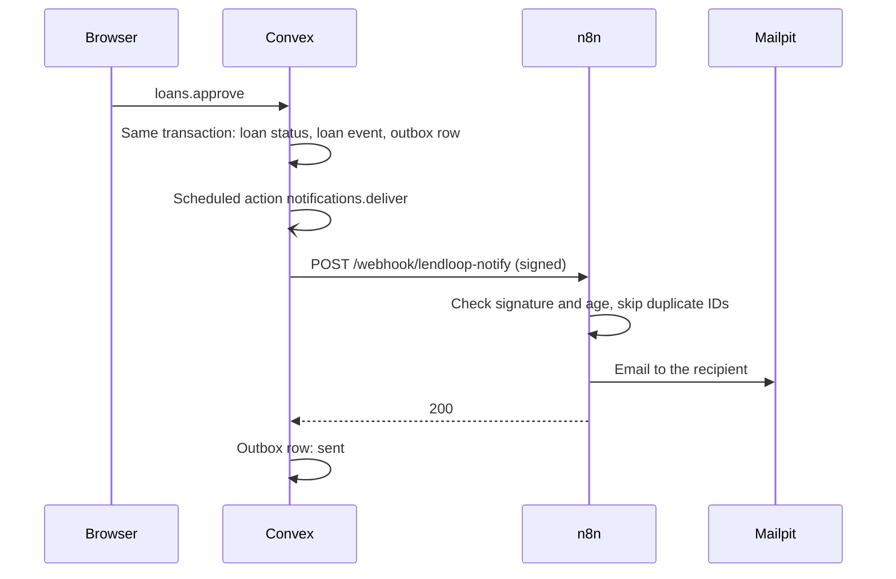
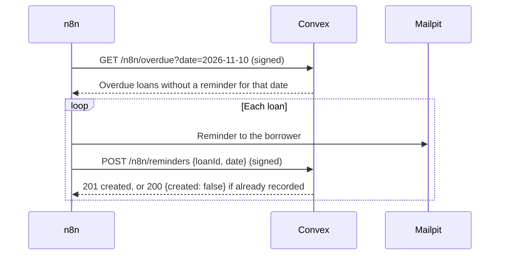

# LendLoop

Borrow what you need. Lend what you don't.

LendLoop is a neighborhood tool-lending board. Neighbors list tools they can lend, request to borrow tools for a date range, and get automated notifications and overdue reminders through n8n.

## Stack

- Next.js 16 (App Router), React 19, TypeScript, Tailwind CSS 4
- shadcn/ui components on Base UI primitives (`components/ui`)
- Clerk for authentication
- Convex for data and backend logic
- n8n for workflow automation
- pnpm as the package manager

## Data model

The schema is in `convex/schema.ts`.

| Table | Purpose |
|---|---|
| `users` | One row for each Clerk user. Has the `admin` or `user` role, and the `trustedLender` flag. |
| `tools` | Tool listings: name, category, condition, description, owner, and status (`active` or `removed`). |
| `loans` | Borrow requests and loans for a date range. |
| `loanEvents` | Loan activity, from users and from n8n (for example `reminder_sent`). |
| `notifications` | Outbox for n8n request notifications: `pending`, `sent`, or `failed`, with the attempt count and the last error. |

Loan status changes:

```
requested -> approved -> returned
requested -> declined
requested -> cancelled
```

### Decisions

- **Categories and conditions are fixed lists in code.** The filter cannot get duplicates such as "Garden" and "gardening". To add a value, change the schema and deploy. If the list must change often, move it to a table that admins manage.
- **Deleting a tool is a soft delete.** The status changes to `removed`, and the tool does not show in lists. Loans keep a valid reference to the tool.
- **Availability is calculated, not stored.** A tool is "on loan" when it has an approved loan that includes today, or an approved loan that is overdue. If availability were also stored on the tool, the two values could disagree. An available tool with a future approved loan also shows "Booked from <date>".
- **The client sends "today" to queries that show availability.** Convex does not re-run a query when `Date.now()` changes ([Convex best practices](https://docs.convex.dev/understanding/best-practices/#date-in-queries)). The client sends its local date. The date changes once a day, so query caching stays effective. "Today" is the user's local date, which is correct for a neighborhood app.
- **The public list shows all active tools,** with name and category only. It does not show availability, owners, or IDs.
- **Signed-in users see the owner's name and Trusted Lender badge,** but never the owner's email.
- **Only the owner can edit a tool.** Admins can remove any tool, but cannot edit it. When a tool is removed, Convex declines its pending requests. Approved loans stay, because the borrower must still return the tool.
- **Signed-in list queries return no data to signed-out callers, and do not throw.** On sign-out, the Convex client re-runs open queries without a token before the page can stop them. An error there only adds noise to the logs. Mutations, and admin queries for non-admins, still throw.
- **The header shows count badges** for requests that wait for your answer and for your overdue loans. These are the two cases where the user must act. Status changes reach users through the n8n notifications, so the app does not track "seen" state.
- **Lists show at most 200 tools.** Pagination is a later step.
- **Dates are calendar dates (`YYYY-MM-DD`).** A loan covers full days, and there are no timezone conversions. Strings in this format compare correctly.
- **Overlapping requests:** pending requests can overlap. A request cannot overlap an approved loan. Convex checks this when the request is created, and again when the lender approves it. When the lender approves a request, Convex declines the other pending requests that overlap it, and notifies those borrowers.
- **Only the lender marks a loan returned,** because the lender receives the tool. `returnedAt` records the time. A return after `endDate` is a late return. Until the lender marks it returned, the loan is overdue and n8n sends reminders.
- **The borrower can cancel a request** while its status is `requested`.
- **A borrower cannot send two overlapping requests for the same tool.** Different borrowers can.
- **Mutations check the client's "today".** The borrower's local date decides if a start date is in the past. Convex accepts a client date only within one day of the server date, so a client cannot move "today" far back.
- **Overdue is not a status.** A loan is overdue when its status is `approved` and its `endDate` is before today.
- **Loan activity shows automation results.** Each loan in My requests, Incoming, and the admin loan list shows the last n8n reminder ("Reminder sent 2 days ago", with the count) and the delivery status of the latest notification email. It shows times and statuses only, no message content.
- **Trusted Lender is a badge.** Admins give it to reliable lenders. Signed-in users see it next to the lender's name. It changes no loan rules.
- **The admin user list shows names, not emails.** The Trusted Lender decision needs no contact data.
- **Owners cannot block dates.** The requirements do not include this. The owner controls each loan with approve and decline. A possible next step is a `toolBlocks` table, checked with the same overlap rule as loans.

## Pages

| Path | Who | What |
|---|---|---|
| `/` | Anyone | Marketing page: tagline, how it works, the public tool list (name and category only), and sign-in. |
| `/sign-in` | Anyone | Clerk sign-in and sign-up in one flow, styled with the app theme. |
| `/tools` | Signed-in users | All tools with availability, filtered by category (`?category=garden`). Request a tool for a date range. Edit or remove your own tools. Admins can remove any tool here. |
| `/my-listings` | Signed-in users | Your tools. Add, edit, and remove. |
| `/requests` | Signed-in users | "My requests": tools that you asked to borrow. Cancel a pending request. |
| `/incoming` | Signed-in users | "Incoming requests": requests for your tools. Approve, decline, and mark returned. |
| `/admin` | Admins | All loans with a status filter and activity, all listings with remove, users with the Trusted Lender switch, and notifications that failed or are retrying, with **Retry**. |

`proxy.ts` sends signed-out visitors from signed-in pages to Clerk sign-in. This is for UX only. The Convex functions check access on each call.

The browser sends its local date to the availability queries. The date is read only in the browser, because the server does not know the user's time zone, and Next.js prerenders pages with Cache Components.

## Access control

All access control is in the Convex functions. Anyone can call a public Convex function directly, so the UI checks are only for display.

Rules:

- **Identity comes from the verified Clerk token** (`ctx.auth`). No function accepts a user ID or a role from the client.
- **The role is stored in the `users` table.** New users get `user`. Only the internal functions `users:grantAdmin` and `users:revokeAdmin` change it (`pnpm admin:grant`). The browser cannot call internal functions.
- **Shared checks:** `requireUser`, `requireAdmin` (`convex/lib/auth.ts`), and `getLoanFor(lender | borrower)` (`convex/loans.ts`).
- **Two kinds of rule:** the role (`user` or `admin`), and ownership (the tool owner, the lender, or the borrower of a loan).
- **An admin is a user with extra rights.** Admins can also lend and borrow, under the same ownership rules as everyone else.
- **Each query returns only the fields that its caller needs.** No list returns an email.

| Function | Anyone | User | Admin | Rule | Test (`convex/*.test.ts`) |
|---|---|---|---|---|---|
| `tools.listPublic` | ✓ | ✓ | ✓ | Name and category only | listPublic › returns only name and category of active tools, without sign-in |
| `tools.list`, `tools.mine` | Empty | ✓ | ✓ | `mine`: own tools only | list › returns no tools to a caller that is not signed in. mine › returns only the caller's active tools |
| `tools.create` | ✗ | ✓ | ✓ | The owner is the caller | create › sets the owner from the token and trims input. create › rejects a caller that is not signed in |
| `tools.update` | ✗ | Owner | Owner | Admins cannot edit other users' tools | update › rejects other users and admins |
| `tools.remove` | ✗ | Owner | Any tool | Declines pending requests | remove › lets the owner and admins remove a tool, but not other users |
| `loans.request` | ✗ | ✓ | ✓ | Not your own tool | request › rejects the owner's own tool. request › rejects a caller that is not signed in |
| `loans.approve`, `loans.decline`, `loans.markReturned` | ✗ | Lender | Lender | | approve › rejects the borrower and other users. decline and cancel › the lender declines, and the borrower cannot. markReturned › rejects the borrower and a loan that is not approved |
| `loans.cancel` | ✗ | Borrower | Borrower | Only while `requested` | decline and cancel › the borrower cancels a request, and the lender cannot |
| `loans.myRequests`, `loans.incoming`, `loans.navCounts` | Empty | Own loans | Own loans | Names, no emails | lists › myRequests and incoming show only the caller's loans, with names and no emails. signed out › list queries return no data, and mutations still reject |
| `loans.bookedRanges` | Empty | ✓ | ✓ | Dates only | bookedRanges › returns only the dates of approved loans, and nothing when signed out |
| `loans.listAll` | ✗ | ✗ | ✓ | | lists › listAll is for admins only |
| `users.listForAdmin` | ✗ | ✗ | ✓ | Names, no emails | Trusted Lender › listForAdmin returns names and tool counts, never emails, to admins only |
| `users.setTrustedLender` | ✗ | ✗ | ✓ | | Trusted Lender › a normal user cannot mark anyone, including themselves |
| `users.ensureUser`, `users.me` | ✗ / null | Self | Self | Never changes the role | ensureUser › updates email and name but keeps the role. me › returns null when not signed in |
| `users.grantAdmin`, `users.revokeAdmin`, `seed.run` | Internal | Internal | Internal | CLI with deployment access only | grantAdmin and revokeAdmin › grant, grant again, revoke, revoke again |

✓ allowed. ✗ rejected with an error. "Empty" returns no data. Signed-out callers get no data from list queries, because the Convex client re-runs open queries without a token during sign-out.

## Automation (n8n)

Convex is the source of truth: it decides who may do what, and what is overdue. n8n delivers messages and runs the schedule. The workflow files are in `n8n/workflows`, and `make n8n-setup` imports them.

| Workflow | Trigger | What it does |
|---|---|---|
| **LendLoop: Request notification** | Webhook, called by Convex | Emails the lender about new and cancelled requests, and the borrower about approvals, declines, and returns. |
| **LendLoop: Overdue reminders** | Every day at 09:00 (n8n time zone, `TZ` in `compose.yaml`), or **Run now** | Gets the overdue loans from Convex, emails each borrower, and writes each reminder back to Convex. |
| **LendLoop: Error alerts** | Any failed run of the two workflows above | Emails the workflow name, the failed node, and the error to `ops@lendloop.local`. |

In local development, all email goes to Mailpit.

### Request notification



- **Outbox:** the loan mutation writes a `notifications` row in the same transaction as the status change. A committed change always has a queued notification.
- **Retries:** if n8n does not answer with 2xx, Convex tries again after 30 seconds, 2, 10, and 30 minutes. After 5 attempts, the row is `failed` with the last error. Admins can list and retry failed rows (`notifications.listProblems`, `notifications.retry`).
- **Duplicates:** each notification has a stable ID. n8n records the IDs that it emailed and skips a repeated delivery.
- **Data minimization:** the payload has the event, the tool name, the dates, the recipient's name and email, and the other person's name. It has no other email address and no user IDs.

### Overdue reminders



- **Idempotent write-back:** Convex stores each reminder as a `reminder_sent` loan event with the key `reminder:<loanId>:<date>`. A repeated request (an n8n retry, or a second run on the same day) creates nothing and returns `{ "created": false }`. A loan that already has a reminder for the date is not listed again.
- **Retries:** the n8n HTTP and email nodes retry 3 times, 5 seconds apart. If they still fail, the run fails and the error workflow sends an alert.

### Request signing

Every request between Convex and n8n is signed with HMAC-SHA256, in both directions, with a different secret for each direction.

- Headers: `X-LendLoop-Timestamp` (Unix seconds) and `X-LendLoop-Signature` (hex).
- Signed message: `<timestamp>.<METHOD>.<path and query>.<body>`. A signature is valid only for that exact request.
- The receiver rejects a missing or wrong signature, and a timestamp more than 5 minutes from its own clock (replay protection), with HTTP 401. Signatures are compared in constant time.
- Convex: `convex/lib/signature.ts` and `convex/http.ts`. n8n: a Code node rebuilds the message from the raw request body, and a Crypto node computes the HMAC with the secret from an n8n credential.
- **The exported workflow JSON contains no secrets.** It refers to the credentials by ID. `make n8n-setup` creates the credentials from the Convex environment variables.
- n8n blocks access to environment variables in workflows by default (n8n 2.x). This setting is kept. The Convex URL (`http://host.docker.internal:3211`) and the app URL are plain values in the workflow files, because they are not secret. For another environment, change the Convex URL in the **Get overdue loans** and **Record reminder** nodes, and the app URL in the **Compose email** and **Compose reminder** nodes.

## Development setup

Each developer runs their own local Convex backend and uses their own Clerk development app. No secrets are shared between developers, and no secrets are committed to the repository.

Follow every step in order. Do not skip a step because it looks optional. Each step was tested on 2026-10-31 with Node.js 26.11.1, pnpm 12.11.2, Convex CLI 1.48.0, and `@clerk/nextjs` 7.9.22. Dashboards change over time. If a screen does not match these steps, check the current [Convex + Clerk docs](https://docs.convex.dev/auth/clerk) before you continue.

### Prerequisites

- Node.js 22.12 or later (required by Vitest)
- pnpm
- GNU Make (`make`). macOS includes it with the Xcode Command Line Tools.
- [Hivemind](https://github.com/DarthSim/hivemind), for `make dev` (`brew install hivemind`)
- A container engine with Compose, for n8n and Mailpit. One of:
  - Docker with the Docker Compose plugin (`docker compose`)
  - Podman with a Compose provider (`podman compose`). On macOS, start the Podman machine first (`podman machine start`).
- A Clerk account (free) at [dashboard.clerk.com](https://dashboard.clerk.com)

A Convex account is not required for local development.

Tested with GNU Make 3.81, Hivemind 1.1.0, and Podman 6.1.4 with podman-compose. The Makefile uses `podman compose` if Podman is installed, and `docker compose` if it is not.

### 1. Install dependencies

```sh
git clone <repository-url> lendloop
cd lendloop
pnpm install
```

### 2. Start the local Convex backend

```sh
pnpm exec convex dev
```

1. Do not use `--configure new`. That option forces a Convex account login.
2. When the CLI asks "Would you like to login to your account?", select **Start without an account (run Convex locally)**.
3. Wait for the message `Convex functions ready!`.
4. Keep this terminal open. The local backend runs only while `convex dev` runs.

The CLI writes `CONVEX_DEPLOYMENT`, `NEXT_PUBLIC_CONVEX_URL`, and `NEXT_PUBLIC_CONVEX_SITE_URL` to `.env.local`. Do not edit these values.

### 3. Create a Clerk development app

1. In the Clerk dashboard, create an application:
   - Application type: **Consumer**
   - Name: `LendLoop`
   - Sign-in options: **Email** and **Google** on. All other options off, including **Phone number**.
2. Skip the "Add authentication to your app" page. Do not use its agent prompt or the Clerk CLI. The code is already in this repository.
3. Open [dashboard.clerk.com/apps/setup/convex](https://dashboard.clerk.com/apps/setup/convex). Select your workspace, the `LendLoop` application, and the **Development** instance. Select **Activate Convex integration**.
4. **Required: add the `email` and `name` claims to the session token.** Clerk session tokens do not include them by default, and the Convex integration adds only `aud`. Without this step, sign-in works but your user is not created, and the browser console shows `Clerk token has no email claim`.
   1. In the Clerk dashboard, select **Configure** in the top menu.
   2. Select **Sessions** in the left menu.
   3. In the **Claims** editor, replace the content with:

      ```json
      {
        "aud": "convex",
        "email": "{{user.primary_email_address}}",
        "name": "{{user.full_name}}"
      }
      ```

   4. Select **Save** in the "Unsaved changes" bar at the bottom of the page.
   5. Check the **Preview**. It must show your email. `"name": null` is OK. The app then uses the email as the name.
5. Select **Configure**, then **API keys** in the left menu (under **Instance**).
6. Open `.env.local` in your editor. Add the publishable key from the **Publishable key** section:

   ```
   NEXT_PUBLIC_CLERK_PUBLISHABLE_KEY=pk_test_...
   ```

7. Add a secret key. The `default` secret key is locked and cannot be copied. In the **Secret keys** section, select **Add new key**. Clerk shows the full key only once. Copy it before you close the dialog:

   ```
   CLERK_SECRET_KEY=sk_test_...
   ```

   If you lose the key, create a new one and delete the old one.

8. Add the sign-in page settings to `.env.local`. They make Clerk use the in-app `/sign-in` page, not the Clerk-hosted page:

   ```
   NEXT_PUBLIC_CLERK_SIGN_IN_URL=/sign-in
   NEXT_PUBLIC_CLERK_SIGN_IN_FALLBACK_REDIRECT_URL=/
   NEXT_PUBLIC_CLERK_SIGN_UP_FALLBACK_REDIRECT_URL=/
   ```

### 4. Set the Convex environment variable

Convex functions run in the Convex backend. They do not read `.env.local`. Copy the **Frontend API URL** from the right side of the Clerk **API keys** page. Set it on your Convex deployment with this exact name (not `CLERK_FRONTEND_API_URL`, which the Clerk setup page shows):

```sh
pnpm exec convex env set CLERK_JWT_ISSUER_DOMAIN https://<your-app>.clerk.accounts.dev
```

Check that the `convex dev` terminal shows `Convex functions ready!` with no error.

### 5. Start the app

In a second terminal:

```sh
pnpm dev
```

1. Open [http://localhost:3000](http://localhost:3000).
2. Select **Sign in to lend or borrow**, and sign up.
3. Check that your user menu shows at the top right.
4. Check that Convex created your user:

   ```sh
   pnpm exec convex data users
   ```

   The table must show one row with your email. If it is empty, see [Troubleshooting](#troubleshooting).

### 6. Make yourself an admin (optional)

New users have the `user` role. Admin rights can only be granted with internal Convex functions. The browser cannot call them. Sign in once first, then run:

```sh
pnpm admin:grant you@example.com
```

The result is `"granted"`, or `"already admin"` if you run it again. To check, run `pnpm exec convex data users --format jsonLines` and look at the `role` field.

To remove admin rights:

```sh
pnpm admin:revoke you@example.com
```

The result is `"revoked"`, or `"not admin"`.

These scripts call the internal Convex functions `users:grantAdmin` and `users:revokeAdmin`. `convex dev` must be running.

### 7. Seed test data (optional)

```sh
pnpm seed
```

The script:

1. Creates three Clerk test users in your development instance, or reuses them if they exist: `alice+clerk_test@example.com`, `bob+clerk_test@example.com`, and `carol+clerk_test@example.com`.
2. Creates their Convex user rows and 12 tools. They do not need to sign in first.
3. Creates 10 loans between them, with dates relative to today: two overlapping pending requests, a loan in progress, a future booking, two overdue loans with reminder activity, an on-time return, a late return, a declined request, and a cancelled request.

You can run it more than once. It does not create duplicate users or tools. **Each run replaces the loans between the three test users**, so the dates stay relative to the current day. Loans that involve any other user are never changed. It runs only with a development secret key (`sk_test_`), and `convex dev` must be running.

To sign in as a test user, enter the email, then the code `424242`. Clerk never sends email to `+clerk_test` addresses. To give new test users a password, set `SEED_USER_PASSWORD` in `.env.local` before you run the seed.

### 8. Connect n8n

1. Start the containers:

   ```sh
   make container-up
   ```

2. Open [http://localhost:5678](http://localhost:5678). n8n asks you to create an owner account. This account exists only in your local n8n (in the `n8n_data` volume). It is not an n8n.io account.
   1. Enter any email, your name, and a password (8 or more characters, with 1 number and 1 capital letter).
   2. Leave "I want to receive security and product updates" unchecked. Select **Next**.
   3. Skip the survey (**Get started**), the license key offer, and the AI Assistant (**Set up later in Settings**).
3. With `convex dev` running, run:

   ```sh
   make n8n-setup
   ```

   The script:
   1. Creates the two signing secrets on your Convex deployment (`N8N_NOTIFY_SECRET` and `N8N_API_SECRET`), if they do not exist yet.
   2. Sets `N8N_NOTIFY_URL` on Convex to the local n8n webhook.
   3. Imports three n8n credentials with the same secrets and the Mailpit SMTP settings, and the three workflows in `n8n/workflows`.
   4. Publishes the workflows and restarts n8n.

   It never prints a secret. You can run it again at any time, for example after you change a workflow file.
4. Check the result:
   1. Sign in as Bob (`bob+clerk_test@example.com`) and request one of Alice's tools.
   2. Open Mailpit at [http://localhost:8025](http://localhost:8025). Alice has an email: "Bob Jones wants to borrow your …".
   3. In n8n, open **LendLoop: Overdue reminders** and select **Execute workflow**. Each overdue borrower gets a reminder in Mailpit. Run it again: no new reminders are sent.

If you change the Mailpit or n8n host port (see [Daily development](#daily-development)), use that port in the URLs above.

### Environment variables

| Variable | Where it is set | Source |
|---|---|---|
| `CONVEX_DEPLOYMENT` | `.env.local` | Written by `convex dev` |
| `NEXT_PUBLIC_CONVEX_URL` | `.env.local` | Written by `convex dev` |
| `NEXT_PUBLIC_CONVEX_SITE_URL` | `.env.local` | Written by `convex dev` |
| `NEXT_PUBLIC_CLERK_PUBLISHABLE_KEY` | `.env.local` | Clerk dashboard, **API keys** |
| `CLERK_SECRET_KEY` | `.env.local` | Clerk dashboard, **API keys**. Secret. |
| `NEXT_PUBLIC_CLERK_SIGN_IN_URL` | `.env.local` | `/sign-in` (step 3.8) |
| `NEXT_PUBLIC_CLERK_SIGN_IN_FALLBACK_REDIRECT_URL` | `.env.local` | `/` (step 3.8) |
| `NEXT_PUBLIC_CLERK_SIGN_UP_FALLBACK_REDIRECT_URL` | `.env.local` | `/` (step 3.8) |
| `SEED_USER_PASSWORD` | `.env.local` | Optional. Password for new seed users (step 7). |
| `CLERK_JWT_ISSUER_DOMAIN` | Convex deployment (`convex env set`) | Clerk dashboard, **API keys**, Frontend API URL |
| `N8N_NOTIFY_URL` | Convex deployment | `make n8n-setup` (the local n8n webhook URL) |
| `N8N_NOTIFY_SECRET` | Convex deployment, and the n8n credential "LendLoop signing: Convex to n8n" | `make n8n-setup` (random). Secret. |
| `N8N_API_SECRET` | Convex deployment, and the n8n credential "LendLoop signing: n8n to Convex" | `make n8n-setup` (random). Secret. |

To see the variables and values on your Convex deployment:

```sh
pnpm exec convex env list --include-values
```

Add `--names-only` to hide the values.

### Daily development

```sh
make dev
```

This command starts n8n and Mailpit in containers, then runs Next.js and `convex dev` together with Hivemind (`Procfile.dev`). Press `Ctrl+C` to stop Next.js and Convex. The containers keep running until `make container-down`.

| Service | URL |
|---|---|
| App | http://localhost:3000 |
| n8n | http://localhost:5678 |
| Mailpit (local email inbox) | http://localhost:8025 |

Run `make` to see all commands:

| Command | What it does |
|---|---|
| `make dev` | Start the containers, then Next.js and Convex |
| `make container-up` / `make container-down` | Start or stop n8n and Mailpit. `down` keeps the data volumes. |
| `make container-logs` | Follow the container logs |
| `make seed` | Create the test users, tools, and loans (step 7) |
| `make n8n-setup` | Create the signing secrets, and import the n8n credentials and workflows (step 8) |
| `make test` / `make check` | Run the tests, or type-check, lint, and test |
| `make admin-grant EMAIL=…` / `make admin-revoke EMAIL=…` | Change admin rights (step 6) |

**If a port is in use** (for example, another project's Mailpit on 8025), choose another host port: `make dev MAILPIT_HOST_PORT=8026` or `make container-up N8N_HOST_PORT=5679`. To keep the setting on your machine, put it in `Makefile.local`, which Git ignores:

```make
MAILPIT_HOST_PORT = 8026
```

Without Make, run `pnpm exec convex dev` and `pnpm dev` in two terminals, and `docker compose up -d` (or `podman compose up -d`).

To open the local Convex dashboard in the browser, run `pnpm exec convex dashboard`.

### UI components

The files in `components/ui` come from the shadcn/ui CLI (style `base-nova`, Base UI primitives). To add a component, run:

```sh
pnpm dlx shadcn@latest add <component>
```

Then review the diff before you commit. The theme follows the OS light or dark setting (`next-themes`).

### Tests

The Convex function tests use [`convex-test`](https://docs.convex.dev/testing/convex-test) with Vitest. They run against an in-memory mock backend, so `convex dev` does not need to run.

```sh
pnpm test:once   # run all tests once
pnpm test        # watch mode
```

### Troubleshooting

**`convex dev` asks you to log in.** You used `--configure new`. Press `Ctrl+C` and run `pnpm exec convex dev` with no options.

**`pnpm install` fails with `ERR_PNPM_IGNORED_BUILDS` for esbuild.** `pnpm-workspace.yaml` must contain `esbuild: true` under `allowBuilds`. The Convex CLI needs esbuild.

**The browser console shows `Clerk token has no email claim. Claims present: ...`.** The session token claims are missing. Do step 3.4, select **Save**, then reload the page. The setting applies to all users of the Clerk app, including existing users.

**The `users` table is empty after sign-in.** Read the recent Convex logs:

```sh
pnpm exec convex logs --history 10 --success
```
