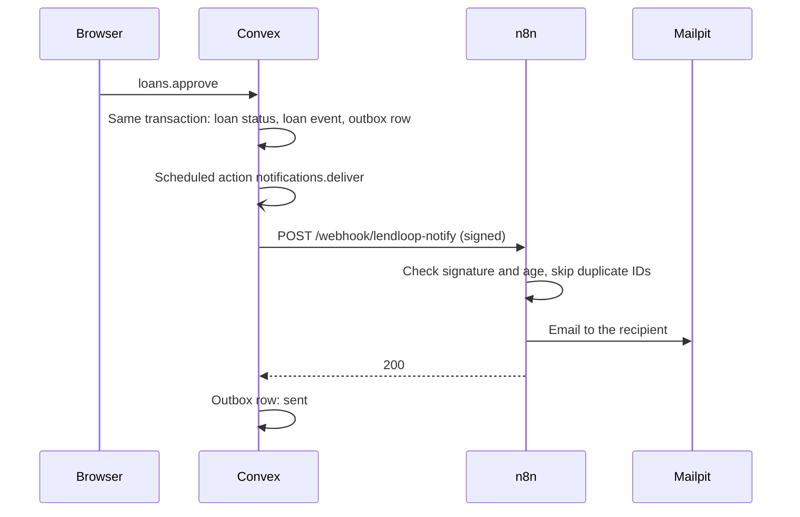
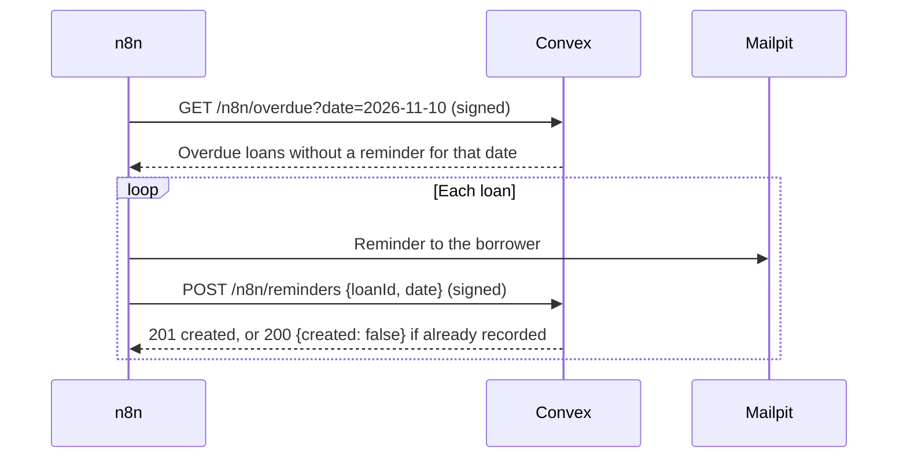

# Automation (n8n)

Convex is the source of truth: it decides who may do what, and what is overdue. n8n delivers messages and runs the schedule. The workflow files are in `n8n/workflows`, and `pnpm setup:n8n` imports them.

| Workflow | Trigger | What it does |
|---|---|---|
| **LendLoop: Request notification** | Webhook, called by Convex | Emails the lender about new and cancelled requests, and the borrower about approvals, declines, returns, and bookings cancelled because the listing was removed. |
| **LendLoop: Overdue reminders** | Every day at 09:00 (n8n time zone: the `TZ` environment variable when the containers start, default UTC), or **Run now** | Gets the overdue loans from Convex, emails each borrower, and writes each reminder back to Convex. |
| **LendLoop: Error alerts** | Any failed run of the two workflows above | Emails the workflow name, the failed node, and the error to `ops@lendloop.local`. |

In local development, all email goes to Mailpit.

## Request notification

- **Outbox:** the loan mutation writes a `notifications` row in the same transaction as the status change. A committed change always has a queued notification.
- **Retries:** if n8n does not answer with 2xx, Convex tries again after 30 seconds, 2, 10, and 30 minutes. After 5 attempts, the row is `failed` with the last error. Admins can list and retry failed rows (`notifications.listProblems`, `notifications.retry`).
- **Duplicates:** each notification has a stable ID. n8n records the IDs that it emailed and skips a repeated delivery.
- **Data minimization:** the payload has the event, the tool name, the dates, the recipient's name and email, and the other person's name. It has no other email address and no user IDs.

## Overdue reminders

- **Idempotent write-back:** Convex stores each reminder as a `reminder_sent` loan event with the key `reminder:<loanId>:<date>`. A repeated request (an n8n retry, or a second run on the same day) creates nothing and returns `{ "created": false }`. A loan that already has a reminder for the date is not listed again.
- **Retries:** the n8n HTTP and email nodes try up to 3 times, 5 seconds apart. If they still fail, the run fails and the error workflow sends an alert.

## Request signing

Every request between Convex and n8n is signed with HMAC-SHA256, in both directions, with a different secret for each direction.

- Headers: `X-LendLoop-Timestamp` (Unix seconds) and `X-LendLoop-Signature` (hex).
- Signed message: `<timestamp>.<METHOD>.<path and query>.<body>`. A signature is valid only for that exact request.
- The receiver rejects a missing or wrong signature, and a timestamp more than 5 minutes from its own clock (replay protection), with HTTP 401. Signatures are compared in constant time.
- Convex: `convex/lib/signature.ts` and `convex/http.ts`. n8n: a Code node rebuilds the message from the raw request body, and a Crypto node computes the HMAC with the secret from an n8n credential.
- **The exported workflow JSON contains no secrets.** It refers to the credentials by ID. `pnpm setup:n8n` creates the credentials from the Convex environment variables.
- n8n blocks access to environment variables in workflows by default (n8n 2.x). This setting is kept. The Convex URL (`http://host.docker.internal:3211`) and the app URL are plain values in the workflow files, because they are not secret. For another environment, change the Convex URL in the **Get overdue loans** and **Record reminder** nodes, and the app URL in the **Compose email** and **Compose reminder** nodes.
